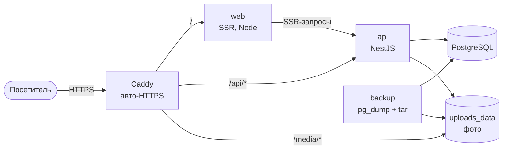

<div align="center">

# BRW Backend

**REST API интернет-магазина мебели BRW (Black Red White), Могилёв**

[](https://brw-market.by)


[Сайт](https://brw-market.by) · [Витрина и админка](https://github.com/Skeinc/BRW-Frontend) · [Документация проекта](../docs/README.md)

</div>

---

## О проекте

Бэкенд магазина [brw-market.by](https://brw-market.by): каталог мебели с категориями, коллекциями, комнатами и готовыми решениями, статьи и новости, заявки с витрины с письмами менеджеру, админ-API для управления контентом и обработка фотографий.

Репозиторий отвечает за API, миграции БД, загрузку и отдачу изображений и production-стек (`docker-compose.prod.yml`, `deploy/`). Витрина и админка живут в [BRW-Frontend](https://github.com/Skeinc/BRW-Frontend).

## Возможности

- **Каталог.** Категории до 3 уровней, коллекции, товары с атрибутами, фильтры и фасеты, сортировка, пагинация.
- **Комнаты и готовые решения.** Наборы товаров коллекции для комнаты; режим «только консультация» (например, кухни) показывает коллекции с «цена от».
- **Контент.** Статьи, новости, слайды главной, редактируемые страницы «Рассрочка» и «Доставка и оплата».
- **Заявки.** Приём заказов с витрины с лимитом попыток, цепочка статусов `new → in_progress → done` или отмена, письмо менеджеру на каждую новую заявку.
- **Фото.** Загрузка jpeg, png, webp до 10 МБ, конвертация в webp до 1600 px плюс превью 480 px, галереи с обложкой и порядком.
- **SEO.** Данные для `sitemap.xml`, 301-редиректы при смене slug (`slug_redirect`).
- **Админ-API.** Вход по логину и паролю (JWT в cookie), все маршруты под `/api/admin/*`.
- **Эксплуатация.** Health-check, Swagger, helmet, gzip, лог запросов, единый формат ошибок `{ code, message, details }`, ежедневные бэкапы БД и фото.

## Архитектура



Один хост `https://brw-market.by`: Caddy проксирует `/api/*` в API, отдаёт `/media/*` с диска и всё остальное отправляет в SSR-витрину. `www` редиректит на домен без `www`.

## Стек

| Слой | Технологии |
| --- | --- |
| Фреймворк | NestJS 12, TypeScript (ESM), class-validator |
| База данных | PostgreSQL 18, Drizzle ORM + drizzle-kit (миграции применяются при старте `api`) |
| Фото | sharp, multer, хранение на диске (`UPLOADS_DIR`), отдача по `/media` |
| Безопасность | helmet, throttler (лимит входа и заявок), bcrypt, JWT в httpOnly-cookie |
| Почта | nodemailer (SMTP) |
| Инфраструктура | Docker Compose, Caddy, GitHub Actions → GHCR → SSH-деплой |
| Качество | oxlint (type-aware), prettier, husky, typecheck |

## Быстрый старт

### Через Docker Compose

```bash
cp .env.example .env   # задайте ADMIN_LOGIN, ADMIN_PASSWORD и JWT_SECRET
docker compose up --build
```

Поднимаются `postgres` (порт 5434), `api` (порт 3000) и `web` (витрина, порт 8080). Миграции применяются при старте `api`. Загруженные фото лежат в volume `uploads_data` и отдаются по `/media`.

```bash
curl http://localhost:3000/api/health
# { "status": "ok", "db": "ok", "storage": "ok" }
```

Swagger: <http://localhost:3000/api/docs>.

Если том `postgres_data` остался от прошлых запусков с другой схемой, пересоздайте его: `docker compose down -v`.

### Без Docker

Нужны Node.js 24 и PostgreSQL.

```bash
npm install
cp .env.example .env   # DATABASE_URL укажите на localhost; фото пишутся в UPLOADS_DIR (по умолчанию ./uploads)
npm run db:migrate
npm run start:dev
```

Можно поднять только инфраструктуру: `docker compose up postgres`.

## Админ-API

Вход в админку: `ADMIN_LOGIN` и `ADMIN_PASSWORD` из `.env`, без них compose не стартует. Вместо открытого пароля можно задать bcrypt-хеш в `ADMIN_PASSWORD_HASH` (`npm run admin:hash -- <пароль>`, значение в одинарных кавычках), он используется, только если `ADMIN_PASSWORD` пуст. Админ-API живёт под `/api/admin/*`: войдите через `POST /api/admin/auth/login` в Swagger, дальше cookie подставляется сама.

`JWT_SECRET` обязателен: сгенерируйте свой (`openssl rand -hex 32`). В production (в Docker) заготовки из репозитория отклоняются, приложение не стартует. Токен привязан к текущим логину и паролю: после смены любого из них старые cookie перестают работать. За reverse proxy задайте `TRUST_PROXY` (число прокси, nginx = 1), иначе лимит попыток входа (5 в минуту) общий для всех клиентов.

Все маршруты под `/api/admin/*` без cookie отвечают `401 UNAUTHORIZED`.

| Раздел | Маршруты |
| --- | --- |
| Вход | `POST auth/login` (5 попыток в минуту), `POST auth/logout`, `GET auth/me` |
| Категории | `categories`: страница дерева с поиском и фильтрами (`GET ?page&pageSize&q&isPublished&depth`: страница это ровно pageSize строк дерева (родители перед детьми)), `GET tree` (всё дерево для выбора родителя), CRUD, `PATCH :id/move` (порядок среди соседей), до 3 уровней |
| Коллекции | `collections`: страница списка с поиском и фильтрами (`GET ?page&pageSize&q&isPublished&hasProducts`), `GET options` (все коллекции как id и название для выбора), CRUD, `PATCH :id/move` (порядок) |
| Товары | CRUD `products`, список с фильтрами `categoryId`, `collectionId`, `q`, `isPublished` |
| Комнаты | `rooms`: список, CRUD, `PATCH :id/move` (порядок). Комната с `isConsultationOnly` (например, «Кухни») без готовых решений и корзины: показывает привязанные коллекции (`collectionIds` по порядку) с фото, текстом и «цена от» (`priceFrom` коллекции) |
| Готовые решения | CRUD `solutions`: набор товаров коллекции для комнаты |
| Новости | CRUD `news` |
| Слайды | CRUD `slides`, `PATCH :id/move` (порядок) |
| Страницы | `GET/PUT installment-page` (рассрочка), `GET/PUT delivery-page` (доставка и оплата): редактируемое содержимое |
| Статьи | CRUD `articles` |
| Заявки | `GET orders` (фильтр `status`, поиск `q` по номеру, имени и телефону; телефон ищется и по цифрам, без учёта пробелов и скобок), `GET orders/:id`, `PATCH orders/:id` (смена статуса по цепочке `new → in_progress → done`, отмена; иначе `ORDER_STATUS_INVALID`) |
| Фото | `products`, `categories`, `collections`, `articles`: `GET/POST /:id/images`, `PATCH /:id/images/order`, `PATCH/DELETE /:id/images/:imageId`; картинки в тексте статей: `POST/DELETE media/images` |

Общие правила: slug строится из названия (кириллица транслитерируется) или задаётся явно, повтор даёт `409 SLUG_TAKEN`, смена slug сохраняет старый в `slug_redirect`. Цены передаются строками (`"1299.00"`). Ошибки приходят как `{ code, message, details }`.

Фото обрабатывает модуль `media`: jpeg, png или webp до 10 МБ превращаются в webp до 1600 px плюс превью 480 px. Первая картинка галереи считается обложкой.

## Публичное API

Без авторизации, под `/api`:

| Маршрут | Назначение |
| --- | --- |
| `GET categories`, `GET categories/:id` | дерево категорий и карточка категории |
| `GET collections`, `GET collections/:id` | коллекции |
| `GET rooms`, `GET rooms/:id`, `GET rooms/:roomId/collections/:collectionId`, `GET rooms/collection/:collectionId/solutions` | комнаты, их коллекции и готовые решения |
| `GET products` | каталог: фильтры, сортировка, `page`, `pageSize` (максимум 48) |
| `GET products/facets` | значения фильтров для текущей выборки |
| `GET products/:id` | карточка товара |
| `GET articles`, `GET articles/:id` | статьи (`pageSize` максимум 48) |
| `GET news`, `GET news/:id` | новости |
| `GET slides` | слайды главной |
| `GET installment-page`, `GET delivery-page` | содержимое страниц рассрочки и доставки |
| `POST orders` | заявка с витрины (лимит попыток) |
| `GET seo/urls` | slug и `updatedAt` опубликованных сущностей для sitemap |
| `GET seo/resolve` | новый адрес переименованного slug (для 301) |
| `GET health` | состояние API, БД и хранилища |

Видимы только опубликованные сущности; товар виден, если вся цепочка его категорий опубликована.

## Структура проекта

```text
src/modules/<модуль>/   module, controller, service, repository
                        + dto/, types/, constants/, lib/, admin/
drizzle/                SQL-миграции
deploy/                 Caddyfile, backup.sh, restore.sh
scripts/                pre-commit, admin-hash
docker-compose.yml      локальная разработка
docker-compose.prod.yml production: Caddy + web + api + Postgres + backup
```

Модули: `admin-auth`, `categories`, `collections`, `rooms` (комнаты и готовые решения), `products`, `articles`, `news`, `slides`, `installment-page`, `delivery-page`, `orders`, `media` (все изображения и галереи), `slug-redirects`, `analytics`, `seo`, `health`. Подробные правила кода: [CLAUDE.md](CLAUDE.md).

## Переменные окружения

Описаны в `.env.example`. Приложение проверяет их при старте и падает с понятным сообщением, если что-то не задано или неверно (значения в ошибке не выводятся).

| Переменная | Назначение |
| --- | --- |
| `PORT`, `NODE_ENV` | порт и режим |
| `DATABASE_URL` | строка подключения PostgreSQL |
| `CORS_ORIGIN` | origin витрины, можно списком через запятую |
| `UPLOADS_DIR`, `PUBLIC_MEDIA_URL` | папка загрузок и публичный URL `/media` |
| `ADMIN_LOGIN`, `ADMIN_PASSWORD` / `ADMIN_PASSWORD_HASH` | вход в админку |
| `JWT_SECRET` | подпись cookie админки (в production заготовка отклоняется) |
| `TRUST_PROXY`, `COOKIE_SECURE` | за reverse proxy: число прокси и secure-cookie (в production `true`) |
| `COOKIE_SAME_SITE` | `lax` (по умолчанию), `strict` или `none`; `none` нужен, когда витрина и API на разных сайтах, и требует `COOKIE_SECURE=true` |
| `ORDER_NOTIFY_EMAIL` | почта менеджера, на которую приходит каждая новая заявка; пусто = писем нет |
| `SMTP_HOST`, `SMTP_PORT`, `SMTP_SECURE`, `SMTP_USER`, `SMTP_PASSWORD`, `MAIL_FROM` | SMTP-сервер для писем (обязателен `SMTP_HOST`, если задан `ORDER_NOTIFY_EMAIL`) |
| `SWAGGER_ENABLED` | Swagger на `/api/docs`; по умолчанию включён вне production и выключен в production |

## Скрипты

| Скрипт | Назначение |
| --- | --- |
| `npm run build` | сборка в `dist/` |
| `npm run start` / `start:dev` / `start:debug` / `start:prod` | запуск |
| `npm run typecheck` | проверка типов (`tsc --noEmit`) |
| `npm run lint` / `lint:fix` | oxlint (type-aware) |
| `npm run format` / `format:check` | prettier |
| `npm run db:generate` | генерация миграций Drizzle |
| `npm run db:migrate` | применение миграций |
| `npm run admin:hash -- <пароль>` | bcrypt-хеш для `ADMIN_PASSWORD_HASH` |
| `npm run pre-commit` | prettier по staged → typecheck → lint |

## Деплой

Production работает в Docker Compose на VPS в Беларуси: Caddy (авто-HTTPS), `web`, `api`, PostgreSQL и контейнер `backup`.

1. Push в релизную ветку запускает GitHub Actions: сборка образа, публикация в GHCR (`ghcr.io/skeinc/brw-backend`), SSH на сервер, `docker compose pull && up -d`.
2. Миграции БД применяются при старте `api`.
3. Откат: `API_TAG` и `WEB_TAG` в `.env.production` на предыдущий тег образа и `docker compose up -d`.
4. Бэкапы: раз в сутки `pg_dump` и архив фото в `~/brw/backups` (хранение 14 дней, `BACKUP_HOUR`, `BACKUP_RETENTION_DAYS`); восстановление через `deploy/restore.sh`.

Пошаговая инструкция (подготовка сервера, секреты GitHub, проверка и откат): [docs/DEPLOY.md](../docs/DEPLOY.md).

## Как добавить товар

Seed-данных нет, каталог наполняется через админку (витрина: `/admin`) или админ-API:

1. Войдите: `POST /api/admin/auth/login` (логин и пароль из `.env`).
2. Убедитесь, что есть опубликованная категория (`POST /api/admin/categories`) и, при необходимости, коллекция.
3. `POST /api/admin/products`: название, `categoryId`, `sku` (уникальный), цена строкой (`"1299.00"`), `isPublished`. Slug строится из названия.
4. Загрузите фото: `POST /api/admin/products/:id/images` (jpeg, png, webp до 10 МБ). Первое фото становится обложкой.
5. Опубликуйте товар. Он появится в каталоге и в `sitemap.xml` витрины сразу, если опубликована вся цепочка его категорий.

## Разработка

- Ветки: `feature/*` → PR в `develop` → релизная ветка. Прямых коммитов в `develop` и `main` нет.
- Коммиты: Conventional Commits.
- Husky запускает `npm run pre-commit` перед каждым коммитом (хуки ставятся при `npm install`, скрипт `prepare`).
- CI на PR в `develop`: `typecheck`, `lint`, `format:check`. Тестов на бэкенде нет по решению проекта.
- Соглашения по коду: [CLAUDE.md](CLAUDE.md).

---

<div align="center">

Сайт: **[brw-market.by](https://brw-market.by)** · Фронтенд: **[BRW-Frontend](https://github.com/Skeinc/BRW-Frontend)**

</div>
